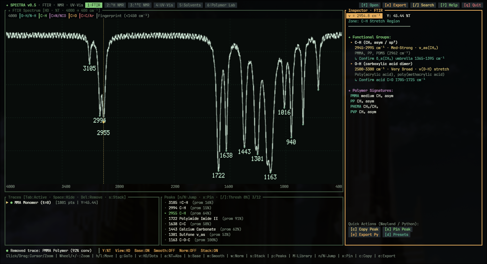
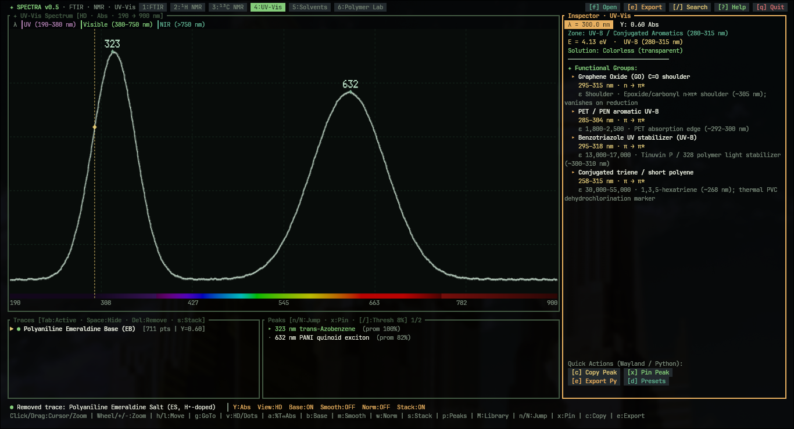
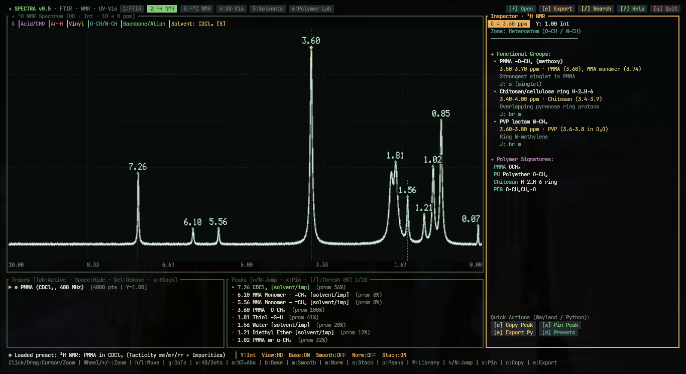
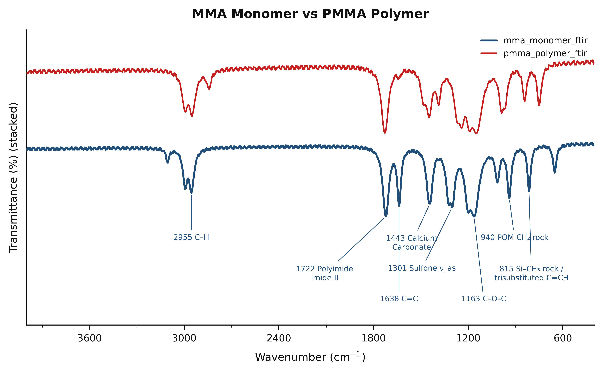

# SPECTRA v0.5.0

**Offline Terminal Workbench for FTIR, ¹H NMR, ¹³C NMR & UV-Vis Spectroscopy and Polymer Chemistry**

Written in **Rust** with optional **Python (Matplotlib/SciPy)** tools • by **Muhammad Musavi**

---

## Screenshots

| Feature | Screenshot |
|---------|------------|
| FTIR HD (Kitty Graphics) |  |
| UV-Vis HD (with Rainbow Strip) |  |
| NMR HD |  |
| Publication Export (ACS Style) |  |

---

## Core Features

### 6 Interactive Tabs
| Key | Tab | Description |
|-----|-----|-------------|
| `1` | **FTIR** | 4000→400 cm⁻¹ (IUPAC reversed), %T/Abs, polymer refs |
| `2` | **¹H NMR** | ppm→0, solvent/impurity markers (CDCl₃, DMSO-d₆, D₂O…) |
| `3` | **¹³C NMR** | ppm→0, DEPT-aware solvent references |
| `4` | **UV-Vis** | **Ascending 190→900 nm**, Tauc band gap, Beer-Lambert, color |
| `5` | **Solvents** | Fulmer 2010 / Babij 2016 tables, searchable, ¹H/¹³C toggle |
| `6` | **Polymer Lab** | 5 calculators (see below) |

### Dual Rendering (`v` toggles)
- **HD Kitty Graphics** — Pixel-sharp anti-aliased oscilloscope in Kitty terminal
  - UV-Vis: **Physical 380–750 nm visible-light rainbow strip** at bottom
  - Non-overlapping bitmap peak labels
- **Portable Braille** — Works in any 24-bit terminal (tmux, alacritty, foot, VS Code, SSH)

### Real File Parsers & Image Digitizer (`f` / `F`)
- **Text formats**: `.csv`, `.tsv`, `.txt`, `.dpt`, `.asc`, `.xy`
  - European decimal commas (`,` → `.`)
  - Latin-1 vendor files (Bruker, PerkinElmer, Shimadzu, JASCO, Agilent)
- **JCAMP-DX** (`.jdx`, `.dx`) — Full IUPAC decompression:
  - `AFFN`, `PAC`, `SQZ`, `DIF`, `DUP`, `DIFDUP`
- **Offline PNG/JPG Spectrum Digitizer** — Import printed scans, set X-bounds & background, digitize to CSV

### Pure-Rust DSP (Zero Dependencies)
| Key | Operation |
|-----|-----------|
| `a` | Beer-Lambert **%Transmittance ↔ Absorbance** |
| `b` | **Rubberband baseline** (convex-hull, Bruker-style) |
| `m` | **Savitzky-Golay smoothing** (OFF → 5 → 9 → 15 pts) |
| `w` | **Min-Max normalization** (overlay helper) |
| `p` | **Prominence peak detection** + parabolic refinement |
| `n`/`N` | Jump next/previous peak |
| `x` | Pin/unpin peak at cursor |
| `[`/`]` | Lower/raise peak threshold (2–60%) |

### Spectral Library Matcher (`M` / `Shift+M`)
- **Hit Quality Index (HQI)** = Pearson absorbance + 1st-derivative correlation
- **FTIR**: 39 built-in polymers + `library/ftir/` (520–3760 cm⁻¹ grid)
- **UV-Vis**: `library/uvvis/` — **189 references** (PhotochemCAD + NIST WebBook, 200–800 nm grid)
- Top 25 hits, `Enter` overlays chosen reference

### Polymer Chemistry Lab (Tab 6)
1. **FTIR Polymerization Conversion %** — Monomer vs polymer peak ratios
2. **¹H NMR End-Group** — Number-average molecular weight *Mₙ* & degree of polymerization *DPₙ*
3. **Vinyl/PMMA Tacticity** — *mm/mr/rr* triads & Bernoullian *ρ*
4. **PVDF β-phase** *F(β)* (Gregorio) & **Polyurethane H-Bonding Index**
5. **UV-Vis Tauc Optical Band Gap** *E₉* — **Direct/Indirect** toggle (`t`), R² fit quality  
   **Beer-Lambert Quantitation** — Auto-scaling units (M / mM / µM / nM) (`m` toggles manual *A*)

### Publication-Grade Export (`e`)
- **600 DPI** PNG / SVG / PDF
- **Styles**: ACS (two-column), RSC, Dark Everforest
- **Layout**: Stacked or Overlay
- UV-Vis export includes **visible-light rainbow strip (380–750 nm)**
- Powered by Python Matplotlib (headless)

---

## Installation & Quick Start

### Prerequisites
- **Rust** (stable) — `curl --proto '=https' --tlsv1.2 -sSf https://sh.rustup.rs | sh`
- **Python 3.10+** (for export, digitize, fetch) — `pip install matplotlib scipy numpy pillow`

### Build (100% Offline)
```bash
git clone https://github.com/thesaintlinusstd-max/spectra
cd spectra
cargo build --release --offline
```

### Run
```bash
# TUI (interactive)
./target/release/spectra

# Open files directly
./target/release/spectra file1.csv file2.jdx

# Library lookup by name
./target/release/spectra butane
./target/release/spectra ftir butane      # strict FTIR
./target/release/spectra nmr butane       # strict ¹H NMR
./target/release/spectra cnmr butane      # strict ¹³C NMR
./target/release/spectra uvvis coumarin   # strict UV-Vis

# Headless publication figure
./target/release/spectra export input.csv -o figure.png --style acs --dpi 600

# Help
./target/release/spectra --help
```

---

## Fetching Optional Open Reference Libraries

> **All fetch commands require network + Python.** Core SPECTRA works 100% offline.

| Command | Source | Spectra | Size |
|---------|--------|---------|------|
| `spectra fetch pack --all` | RRUFF + INFRA-ART + MNHN + NIST | ~2,000+ FTIR | ~150 MB |
| `spectra fetch pack --rruff` | RRUFF Inorganic/Minerals | ~1,500 | ~14 MB |
| `spectra fetch pack --infra` | INFRA-ART Pigments/Resins | ~400 | ~8 MB |
| `spectra fetch pack --mnhn` | MNHN Paris Minerals/Organics | ~1,200 | ~48 MB |
| `spectra fetch pack --nist` | NIST Organic (~145 compounds) | ~145 | ~4 MB |
| `spectra fetch pack --uvvis` | **OMLC PhotochemCAD + NIST WebBook UV-Vis** | **189** | ~2 MB |
| `spectra fetch nmr-search <name>` | nmrshiftdb2 (¹H/¹³C) | variable | small |
| `spectra fetch uvvis <CAS>` | NIST WebBook UV-Vis by CAS | 1–4 | small |

**Data Sources (cited with gratitude):**
- **NIST Chemistry WebBook** — UV-Vis & IR (public domain)
- **Zenodo: FTIR-Plastics** (INFRA-ART, MNHN) — CC-BY-4.0
- **OMLC PhotochemCAD** — UV-Vis absorbance spectra (academic use)
- **nmrshiftdb2** — Community NMR database (CC-BY-SA)
- **RRUFF** — Mineral IR/Raman (CC-BY)

---

## Keyboard & Mouse Shortcuts

### Global
| Key | Action |
|-----|--------|
| `1`–`6` | Switch tabs |
| `Tab` | Cycle loaded traces (in spectrum tabs) |
| `v` | Toggle HD Kitty ↔ Braille rendering |
| `f` / `F` | File browser (replace / append) |
| `/` | Global search (files, library, polymers, solvents) |
| `M` | Library matcher (HQI) |
| `e` | Publication export |
| `d` | Built-in demo presets (FTIR, ¹H, ¹³C, UV-Vis) |
| `?` | Help guide |
| `Ctrl+C` | Quit |

### Plot
| Key | Action |
|-----|--------|
| Drag box | Zoom to region |
| Scroll | Zoom around cursor |
| Right-click / `0` / `r` | Reset view |
| `s` | Stack ↔ Overlay layout |

### Peaks
| Key | Action |
|-----|--------|
| `p` | Toggle peak markers |
| `n` / `N` | Next / Previous peak |
| `x` | Pin/unpin peak at cursor |
| `c` | Copy cursor assignment |
| `[` / `]` | Lower/raise threshold |

### NMR (Tabs 2, 3, 5)
| Key | Action |
|-----|--------|
| `S` | Cycle solvent (CDCl₃, DMSO-d₆, D₂O, Acetone-d₆, MeOH-d₄, TMS…) |
| `i` | Toggle solvent/impurity markers |

### Polymer Lab (Tab 6)
| Key | Action |
|-----|--------|
| `h` / `l` | Switch calculator |
| `j` / `k` | Select input field |
| `Enter` | Edit value |
| `m` | Change mode |
| `c` | Copy result |
| `p` | Cycle monomer preset (NMR *Mₙ*) |
| `t` | **UV-Vis: Toggle Tauc Direct/Indirect** |
| `m` | **UV-Vis: Manual absorbance for Beer-Lambert** |

---

## Scientific References & Scope / Disclaimer

### References
- **Fulmer et al.** *Organometallics* **2010**, 29, 2167–2173 (¹H/¹³C solvent shifts)
- **Gottlieb et al.** *J. Org. Chem.* **1997**, 62, 7512–7515 (NMR impurity tables)
- **Babij et al.** *Org. Process Res. Dev.* **2016**, 20, 1628–1634 (extended solvent data)
- **Gregorio & Cestari** *J. Polym. Sci. B* **1994**, 32, 859–870 (PVDF β-phase)
- **Tauc** *Mater. Res. Bull.* **1966**, 1, 35–41 (optical band gap)
- **Socrates** *Infrared and Raman Characteristic Group Frequencies* (Wiley, 2001)

### Scope & Disclaimer
- **Built-in polymer `[Ref]` traces are synthetic educational references** — generated from literature peak positions, not measured instrument data.
- **Image Digitizer is approximate** — accuracy depends on scan quality, axis calibration, and background subtraction. **Use raw instrument files for quantitative work.**
- UV-Vis **absorbed/observed color** and **photon energy (eV)** are computed from the spectrum; color rendering varies by terminal.
- Tauc band gap fits assume direct/indirect allowed transitions; real materials may deviate.
- HQI matcher is a **similarity guide**, not a definitive identification — always confirm with orthogonal methods.

---

## License

**MIT License** — Copyright (c) 2026 Muhammad Musavi

See [LICENSE](LICENSE) for full text.